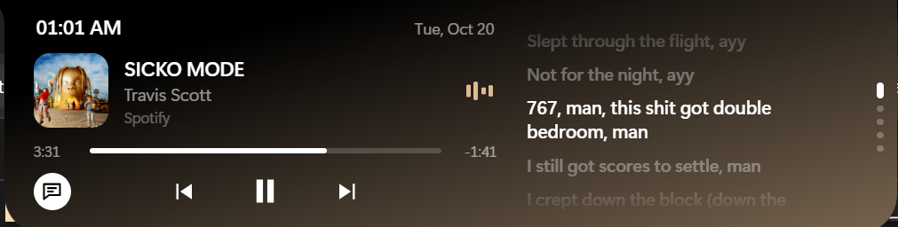

# Dynamic Island for Windows 🏝️

iPhones got a cool little black pill at the top of the screen. Windows got… a taskbar. This fixes that.

Dynamic Island is a small black notch that lives at the top centre of your screen. It shows the time, battery and volume, and when you hover over it, it grows into a music player with lyrics, quick settings, a calendar, a timer and a notepad. Then it politely shrinks back and minds its own business.

Works on **Windows 10 and 11**.

### Here's what it looks like

**Minding its own business** (collapsed): album art, the time, and equalizer bars bouncing along to the music.


**Showing off** (expanded, with lyrics open): the music player on the left, synced lyrics on the right, and a tint borrowed from the album cover.



---

## What's inside

- [What it can do](#what-it-can-do)
- [Installing it](#installing-it)
- [First five minutes](#first-five-minutes)
- [How to drive it](#how-to-drive-it)
- [The views (a guided tour)](#the-views-a-guided-tour)
- [Settings](#settings)
- [Privacy: what goes online](#privacy-what-goes-online)
- [Where your stuff is saved](#where-your-stuff-is-saved)
- [Uninstalling (no hard feelings)](#uninstalling-no-hard-feelings)
- [Something's off? Start here](#somethings-off-start-here)
- [Things it can't do (yet)](#things-it-cant-do-yet)
- [For developers](#for-developers)
- [Credits](#credits)

---

## What it can do

- 🎵 **Music controls** for anything playing on your PC: Spotify, YouTube in your browser, Media Player, you name it. Play, pause, skip, and drag the progress bar to jump to the good part.
- 🎤 **Synced lyrics** that scroll along with the song, so you can finally learn the real words. Click a line to jump to it.
- 🎨 **Colours that match your music:** the island picks up a tint from the album art, and the cover flips over like a card when the song changes.
- 🔋 **Battery, volume and time** at a glance, always.
- ⚙️ **A command centre** with Wi-Fi, Bluetooth, volume and brightness, plus shortcuts for screenshots, locking your PC and more.
- 📅 **A calendar and a timer:** 5, 15, 25 or 50 minutes, with a little chime when time's up.
- 📝 **A notepad** that saves as you type. No "Save" button, no drama.
- 👀 **Peeks:** turn the volume up, plug in your charger, or finish a timer, and the island pops out for a second to let you know.
- 🙈 **Auto-hide:** it tucks itself into a thin line over your browser and code editor, so it never sits on top of your tabs.
- ⛅ **Weather** for your city (optional).
- 🌙 **A Now Playing screen:** a full-screen, lock-screen-style view with a big clock, the album cover, synced lyrics and a blurred album-art background.

---

## Installing it

1. Download **`Dynamic Island Setup <version>.exe`**.
2. Double-click it.
3. Windows will probably say **"Windows protected your PC"**. Don't panic. It says that about every app that hasn't paid for a fancy security certificate. Click **More info → Run anyway**.
4. When it asks who to install it for, pick **Only for me**. It's simpler and doesn't need admin rights.
5. Choose a folder (or keep the default) and click through.
6. Leave **Run Dynamic Island** ticked on the last page, and it appears right away.

You'll get a **Start menu** entry, a **desktop shortcut**, and a proper uninstaller.

**You need:** Windows 10 or 11 (64-bit). That's it. Nothing else to install.

---

## First five minutes

1. **Look up.** The island is at the top centre of your **main** screen.
2. **Find the tray icon.** It's a tiny black pill near the clock on your taskbar. Windows 11 likes to hide new icons behind the **`^`** arrow, so drag it out onto the taskbar where you can see it.
3. **Click the tray icon.** You'll see:
   - **Settings…** where all the knobs and switches live.
   - **Start with Windows.** Tick this and the island shows up by itself every time you turn on your PC. Highly recommended.
   - **Quit Dynamic Island.** Closes it completely. To get it back, open it from the Start menu or desktop shortcut.
4. **Optional:** open Settings and type your city under *Weather*.

---

## How to drive it

| Do this | And this happens |
|---|---|
| **Hover** over the island | It stretches sideways for a moment, then drops open. Move away and it shrinks back. |
| **Click** it | It stays open even when your mouse wanders off. Click it again (or anywhere else) to close it. |
| **Scroll** over it while it's open | Flips to the next screen ("view"). It loops around, so you can't get lost. |
| **Click a dot** on its right edge | Jumps straight to that view. |
| **Scroll over a volume or brightness slider** | Changes that level instead of flipping views. |
| **Right-click** it | Opens Settings. |
| Press **Escape** | Closes it. Handy after typing a note. |

### When it's small (collapsed)

- **Left:** your battery. Green with a little lightning bolt while charging, red when it's at 20% or below and getting nervous. You can swap this for **weather** or the **date** in Settings. PCs without a battery show the date.
- **Middle:** the time.
- **Right:** your volume (or "Muted" when you've silenced it).
- **While music plays:** the album cover on the left and bouncing equalizer bars on the right.
- **While a timer runs:** the countdown takes over the right side.

### Peeks

The island briefly pops out to show you:
- **Volume changes**, from your keyboard keys or anywhere else.
- **Charger plugged in**: the island widens with a glowing green bolt, "Charging" and your battery level. **Unplugged**: the same, in white, saying "On battery".
- **Timer finished**: a bell, the word "Done", and three soft beeps.
- **Bluetooth device connected or disconnected**: a blue Bluetooth icon with the device's name, e.g. "Galaxy Buds2 Pro Connected".

### Auto-hide (a.k.a. tucking)

Some apps keep important things at the top of the screen, like your browser's tabs. When one of those apps is underneath, the island shrinks into a **thin black line** and gets out of the way. Clicks go **straight through it** to your app, as if it isn't there.

- **Want it back?** Rest your mouse on the line at the very top of the screen for a moment. A quick swipe past does nothing, so clicking tabs won't wake it up by accident.
- **It tucks over these apps by default:** Brave, Chrome, Edge, Firefox, Opera, Vivaldi, Arc, VS Code, Antigravity and Task Manager.
- **Three modes:** *Listed apps* (the default), *Any app* (tucks whenever any window is underneath), or *Off* (never tucks). Switch between them with the **Auto-hide** tile in the command centre, or in Settings.
- **Want to add an app?** Open Task Manager, go to the **Details** tab, find the app, and add its name to the list in Settings, without the `.exe`. For example, `Discord.exe` becomes `discord`.

---

## The views (a guided tour)

Scroll over the open island, or click the dots, to move between these. You can hide the ones you don't use and shuffle the order in Settings.

### 🎵 Now playing
*Only shows up when something is playing (or paused).*

- The album art, song name, artist, and which app it's coming from.
- **Click the album art or song name** to jump straight to the app that's playing (Spotify, your browser, …). For browsers it brings up the browser window, but Windows doesn't say *which tab* is playing, so you may still need to find the tab.
- **Previous, play/pause and next** buttons.
- **The progress bar:** hover over it and it grows a little knob. Click or drag anywhere on it to jump to that part of the song. (This works when the music app allows it. Spotify does; some websites don't.)
- **Lyrics** (the little speech-bubble button, bottom left):
  - Tap it and the island stretches out to show lyrics beside the player.
  - If the lyrics are **synced**, they scroll with the song, the current line goes bold, and you can **click any line** to jump to it. Karaoke night is back on.
  - If the lyrics aren't synced, you get plain text you can scroll through.
  - While lyrics are open, the island takes on a colour from the album art.
  - Can't find the song? It'll say so. Spotify songs match best; YouTube titles are a bit of a lucky dip.
  - It remembers whether you left lyrics on or off.
- Got Spotify *and* a YouTube tab going? The island follows whichever one is **actually playing**.

### 🌙 The Now Playing screen

A full-screen view that looks like a phone's lock screen: the date and a big frosted-glass clock, a large album cover, a frosted-glass music card with controls, and lyrics (synced when the song has them, otherwise scrollable text), all over a blurred copy of the album art.

- **Opens by itself** after 2 minutes of not touching your PC, but only while music is *playing*. It never pops up over a full-screen video or game, or while your PC is locked.
- **Open it yourself** with the screen button at the right of the island's music controls, or press **Ctrl + Alt + M** (press it again to close).
- **Top-left buttons:** **✕** closes it; the **speech bubble** shows or hides the lyrics (remembered).
- **To close it,** click the ✕, click anywhere outside the music card, or press **Esc**. Moving the mouse doesn't close it, so you can use the buttons.
- **Don't want it?** Turn it off in Settings → Now Playing. That stops it opening by itself, disables Ctrl + Alt + M, and hides its button.
- It *looks* like a lock screen but **doesn't lock your PC**. To actually lock it, press **Win + L**.

### 🕐 Overview
- A big clock and today's date.
- The weather, if you've set a city: what it's doing outside, the temperature, and today's high and low.
- Your battery level and status ("Charging", "Plugged in", or how long it'll last).
- A volume slider and a mute button.

### ⚙️ Command centre
- **Wi-Fi:** shows which network you're on. Click it to turn Wi-Fi on or off.
- **Bluetooth:** click it to turn Bluetooth on or off.
- **Auto-hide:** click it to cycle between *Listed apps*, *Any app* and *Off*.
- **Shortcut buttons:** Night light settings, Power & battery settings, Screenshot, Lock your PC, and Windows Settings. (The island hides itself before a screenshot, so it doesn't photobomb.)
- **Volume** and **brightness** sliders. Brightness only shows up on laptop screens.

### 📅 Calendar + timer
- **Calendar:** today is circled. Use the arrows to flip months, and click the month name to jump back to today. The week starts on whatever day your Windows region says it does.
- **Timer:**
  - Hit **5m, 15m, 25m or 50m** and it starts straight away.
  - **Start, Pause, Resume** and **Reset** do exactly what you'd hope.
  - When it's stopped, **scroll over the big time** to add or remove a minute.
  - The countdown shows on the small island too, and it chimes when it's done.
  - Even if the island restarts, your timer keeps going.

### 📝 Notes
- A single notepad that **saves as you type**. "Saved" appears in the corner so you know it worked.
- The island stays open while you're typing, even if your mouse wanders. Press **Escape** or click another window when you're done.
- It's one note, not a whole collection. If you delete something, it's gone for good, so choose wisely.

---

## Settings

Open them from the **tray icon → Settings…**, or just **right-click the island**. Pick a section in the sidebar on the left. Everything saves automatically the moment you change it. The Appearance section has a **live preview** of the island that updates as you change things.

| Section | What you can change |
|---|---|
| **Appearance** | **Background opacity:** how see-through the island is (40–100%). **Accent colour:** taken from the album art, or pick one of six colours (or any colour you like). **Left side shows:** battery, weather or date. |
| **Views** | Turn each view on or off, and move it up or down the list. |
| **Auto-hide** | When to tuck away (over these apps, any app, or never), and which apps count: each app is a tag you can remove with ×; type a name and press Enter to add one. |
| **Now Playing** | Turn the **Now Playing screen** on or off. **Lyrics timing** slider (up to 2 seconds either way): lyrics running late? Slide it **right**. Too early? Slide it **left**. |
| **Weather** | Your **city** (press Enter to save) and **°C or °F**. Shows a live weather card once it finds your city. If it didn't, try adding the country, like "Ikeja, Nigeria". Leave the city empty to turn weather off. |
| **System** | **Start with Windows** (same switch as in the tray menu), and a list of handy shortcuts. |

---

## Privacy: what goes online

Short version: **almost nothing**. No accounts, no tracking, no ads, no "we value your privacy" pop-ups.

Only two optional features ever touch the internet:

| Feature | Where it goes | What it sends | When |
|---|---|---|---|
| **Lyrics** | [LRCLIB](https://lrclib.net), a free, open lyrics database | The song's name, artist, album and length | Only while the lyrics panel is open, once per song. |
| **Weather** | [Open-Meteo](https://open-meteo.com), a free weather service | The city you typed, then its map location | Only if you've set a city. Checked when the island starts, when you change the city, and every 15 minutes. |

Everything else (your music, battery, volume, Wi-Fi, which app is open) is read straight from Windows and never leaves your PC.

---

## Where your stuff is saved

Everything lives in one folder: **`%APPDATA%\dynamic-island`**. Paste that into File Explorer's address bar to go there.

| What | Where |
|---|---|
| Settings | `settings.json`, a normal text file |
| Notes, timer, lyrics on/off | Inside `Local Storage\`. This is the app's own little database, so you can't open it in Notepad. |

---

## Uninstalling (no hard feelings)

1. **Turn off "Start with Windows" first** (in the tray menu or Settings). The uninstaller doesn't remove it, and you don't want Windows looking for an app that's gone.
2. Quit the island from the tray.
3. Go to **Settings → Apps → Installed apps → Dynamic Island → Uninstall**.
4. **Optional:** delete the `%APPDATA%\dynamic-island` folder too. The uninstaller leaves your settings and notes behind, just in case you come back. (We'd like that.)

---

## Something's off? Start here

**I can't see the island anywhere.**
It may have been quit. Open it from the Start menu or desktop shortcut. Also, it only lives on your **main** screen. You can change which screen that is in Windows Settings → System → Display.

**The island is just a thin line at the top.**
That's auto-hide doing its job: one of the listed apps is underneath. Rest your mouse on the line at the top of the screen to open it, or change the auto-hide mode.

**It hides over an app it shouldn't (or won't hide over one it should).**
Edit the app list in Settings → Auto-hide. App names are in Task Manager → **Details**, without the `.exe`.

**The music player doesn't show up.**
Your music app needs to work with Windows' media controls. Quick test: press a volume key. If Windows' own little media pop-up shows your song, the island will too. Spotify, browsers and Media Player all work.

**The album art is wrong for a second after switching YouTube videos.**
Browsers update the picture a beat after the title. Give it a few seconds and it catches up.

**"No lyrics found for this song."**
The lyrics database doesn't have it, or the title didn't match. YouTube video titles ("OFFICIAL VIDEO (4K) [REMASTERED]") are the usual suspects. Spotify songs match best.

**The lyrics are ahead of or behind the music.**
Settings → Lyrics → **Timing**. Slide right if they're late, left if they're early.

**I can't drag the progress bar.**
That music app doesn't allow it. Spotify does; some websites don't.

**Where's the brightness slider?**
It only appears on laptop screens. External monitors don't let Windows change their brightness this way.

**Battery, volume, music and Wi-Fi all show nothing.**
The island reads these using small PowerShell scripts (a tool built into Windows). Some work or school PCs block those scripts, and then these features stay blank. Personal PCs are fine.

**Weather can't find my city.**
Try a nearby bigger city, or add the country, like "Ikeja, Nigeria".

**Two islands showed up. Twins!**
You probably have both the installed version and a developer copy set to start with Windows. Turn "Start with Windows" off in one of them.

**"Windows protected your PC" when installing.**
Normal for small free apps. Click **More info → Run anyway**.

---

## Things it can't do (yet)

- **Mac or Linux:** sorry, it's a Windows thing.
- **Multiple screens:** the island stays on your main screen.
- **Brightness on external monitors:** laptop screens only.
- **Switching night light or battery saver on directly:** Windows doesn't let other apps flip those switches, so the buttons open the right Settings page for you instead.
- **More than one note:** it's a single notepad, with no history.
- **A signed installer:** hence the "Windows protected your PC" warning on the first install.

---

## For developers

Want to tinker? Welcome aboard.

### Run it from the code

You'll need [Node.js](https://nodejs.org) (a current LTS version).

```
npm install
npm start
```

Errors show up in your terminal, labelled `[renderer]` (the island) or `[settings]` (the settings window). To poke around with DevTools, start it like this:

```
npx electron . --remote-debugging-port=9223
```

then open `http://127.0.0.1:9223` in Chrome.

### Build the installer

```
npm run dist
```

This makes `dist/Dynamic Island Setup <version>.exe` (using electron-builder). Before building a new release, bump `"version"` in `package.json` so the files don't get mixed up.

Good to know:
- **PowerShell scripts are unpacked.** They sit next to `app.asar` instead of inside it (see `asarUnpack` in `package.json`), because PowerShell can't read files inside that archive. `helper.js` points to the right place.
- **`productName` is set only inside the `build` section,** so the installed app and `npm start` share the same data folder (`%APPDATA%\dynamic-island`). Only one of them runs at a time.
- **"Cannot create symbolic link"?** Turn on Windows Developer Mode (Settings → System → For developers), or run the terminal as administrator, then build again.

### How it works

The island is really one **invisible, always-on-top window** stretched across the top of the screen. Clicks pass straight through it everywhere except over the island itself. The app watches where your mouse is and only "catches" it when it's over the island. (Electron's own mouse tracking gets confused on Windows, so this approach is more reliable.)

Info about Windows (music, battery, Wi-Fi and so on) comes from two small **PowerShell scripts** that run in the background and chat with the app through simple text messages. That means no complicated native add-ons to compile.

| File | What it does |
|---|---|
| `main.js` | The boss. Creates the island window and keeps it in the right place (even when you change screens or scaling), tracks the mouse, runs the tray icon, Settings window and start-with-Windows, and passes messages around. |
| `helper.js` | Starts the PowerShell scripts, listens to them, sends them commands, and restarts them if they crash. |
| `media.ps1` | Reads what's playing from Windows: song info, album art, play state and position. It prefers whichever app is actually playing. Commands: `toggle`, `next`, `prev`, `seek <ms>`. |
| `system.ps1` | Reads volume, battery, brightness, Wi-Fi/Bluetooth and your network, and spots which app is under the island (for auto-hide). Commands: `volume <0..1>`, `mute`, `brightness <0..100>`, `radio <wifi\|bluetooth> <on\|off>`. |
| `lyrics-source.js` | Hunts for lyrics on LRCLIB. It tries an exact match first, then a search by title and artist, then a looser search, and prefers synced lyrics that match the song's length. |
| `weather.js` | Finds your city and fetches the weather from Open-Meteo. |
| `settings-store.js` | Loads, checks and saves `settings.json`, and tells everyone when something changes. |
| `preload.js` | The safe bridge between the island's page and the rest of the app. The shortcut buttons can only open a fixed list of things defined in `main.js`. |
| `index.html`, `styles.css`, `renderer.js` | The island itself: clock, growing and shrinking, views and scrolling, peeks, music, battery/volume and the command centre. |
| `widgets/time.js`, `widgets/notes.js`, `widgets/lyrics.js` | The calendar and timer, the notepad, and the lyrics panel. |
| `widgets/lrc.js` | Reads synced lyrics, shared by the lyrics panel and the Now Playing screen. |
| `widgets/flip.js` | The album-art flip when the song changes, shared by the island and the Now Playing screen. |
| `ambient.html`, `ambient.css`, `ambient.js` | The full-screen Now Playing screen. |
| `settings.html`, `settings.css`, `settings.js`, `settings-preload.js` | The Settings window. |
| `assets/` | The icons, and the Nunito font used by the Now Playing clock (`assets/fonts/`, with its Open Font License). |

**How often it checks things:** volume, battery and the app under the island five times a second; brightness, Wi-Fi and network once a second; music every 0.4 seconds; weather every 15 minutes.

---

## Credits

- Built with [Electron](https://www.electronjs.org) and packaged with [electron-builder](https://www.electron.build).
- Lyrics from [LRCLIB](https://lrclib.net), a free and open lyrics database. 🎤
- Weather from [Open-Meteo](https://open-meteo.com). ⛅
- Clock font: [Nunito](https://github.com/googlefonts/nunito), under the SIL Open Font License.
- Inspired by Apple's Dynamic Island and the Bloom app for Windows.

Made with ☕ and a lot of hovering.
